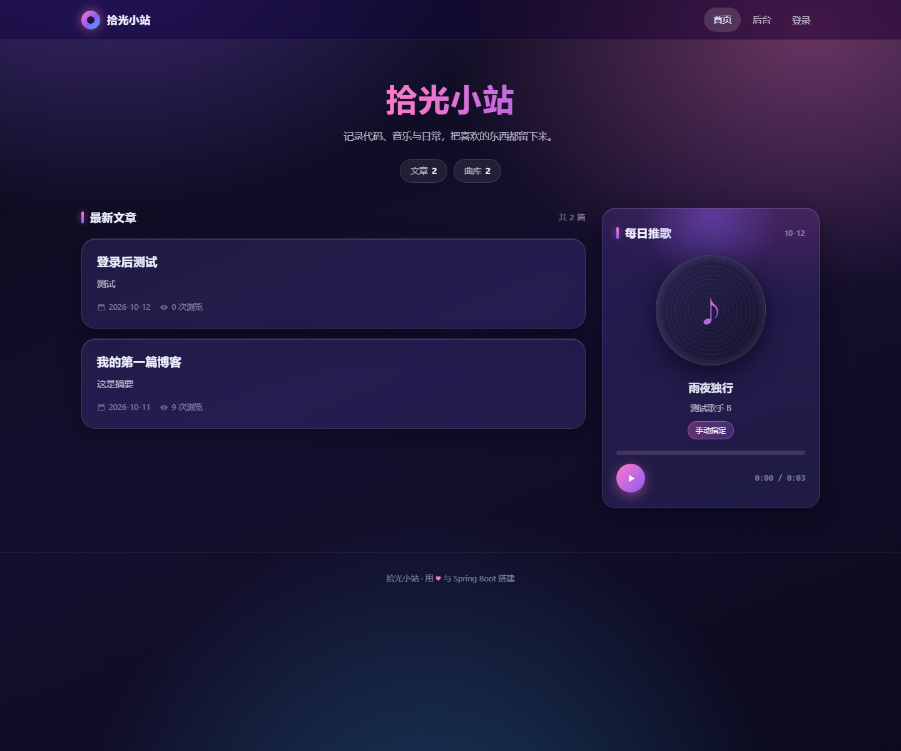
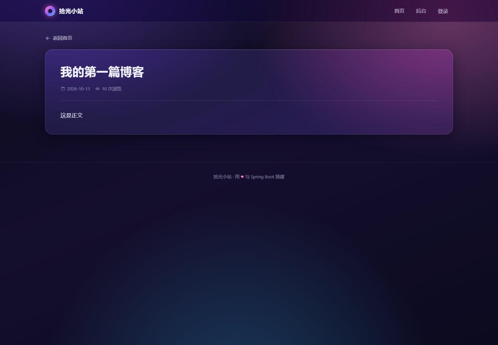
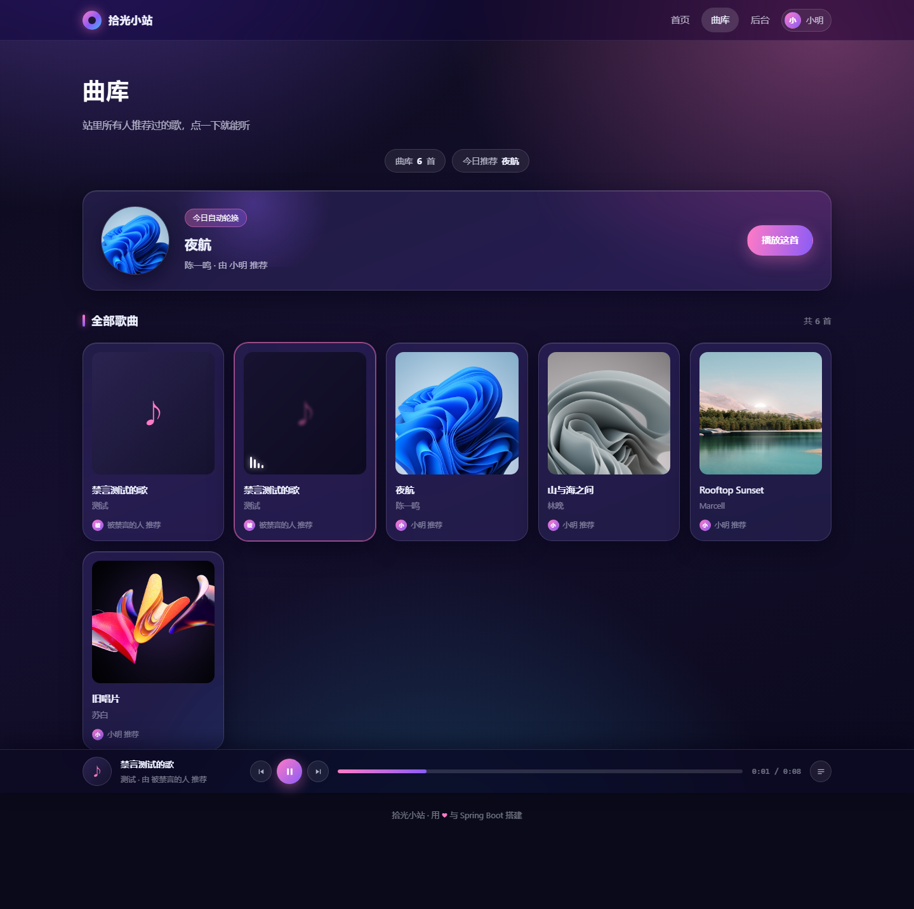
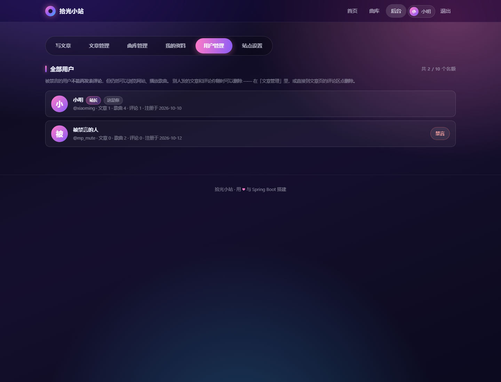
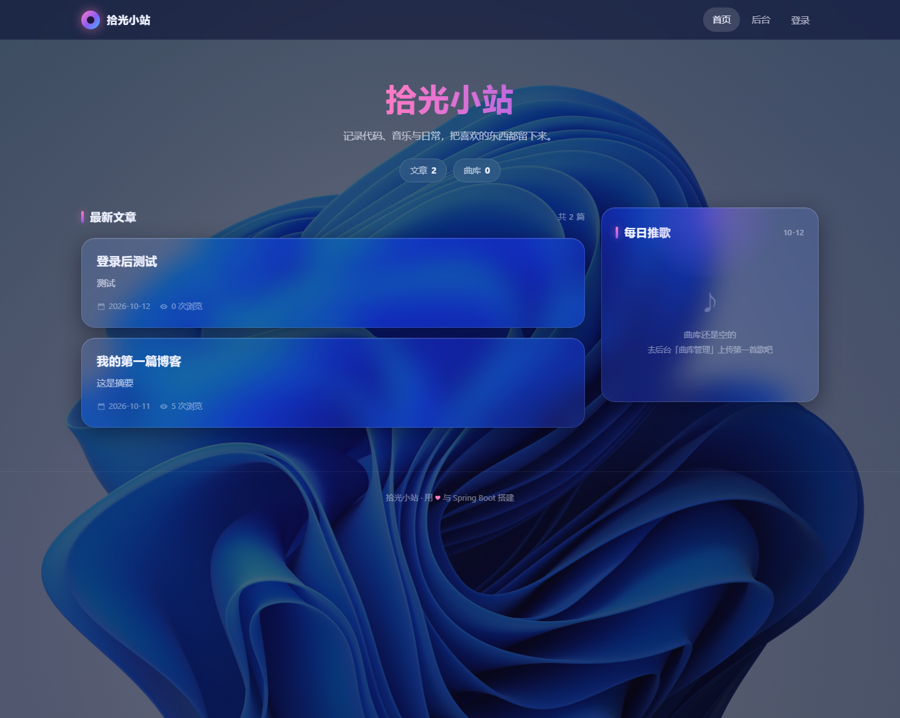
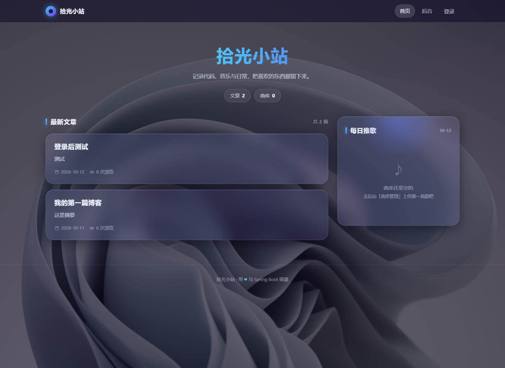
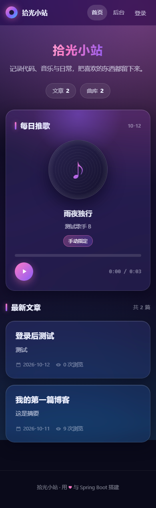

# 拾光小站 · 个人博客

> 记录代码、音乐与日常，把喜欢的东西都留下来。

一个从零手写的个人博客 + 曲库小站：多用户注册发文、评论互动、每日自动推歌、站点主题自定义。
后端 Spring Boot + MyBatis + MySQL，前端**原生 HTML / CSS / JavaScript，零框架、零 CDN、零构建工具**，已部署到阿里云 ECS。

**在线预览**：部署后换成自己的地址，例如 `http://<你的域名或服务器IP>/`

---

## 目录

- [界面预览](#界面预览)
- [功能特性](#功能特性)
- [技术栈](#技术栈)
- [项目结构](#项目结构)
- [快速开始](#快速开始)
- [配置项](#配置项)
- [接口文档](#接口文档)
- [数据库设计](#数据库设计)
- [部署](#部署)
- [几个值得一说的实现细节](#几个值得一说的实现细节)
- [已知问题与后续计划](#已知问题与后续计划)
- [开发过程中如何使用 AI](#开发过程中如何使用-ai)
- [学到了什么](#学到了什么)

---

## 界面预览

| 首页 | 文章详情 |
|---|---|
|  |  |

| 曲库（全局播放器常驻底部） | 后台 · 用户管理 |
|---|---|
|  |  |

| 自定义背景图 + 遮罩 | 从背景图自动提取主题配色 |
|---|---|
|  |  |

<p align="center">
  
  <br />
  <sub>移动端适配</sub>
</p>

---

## 功能特性

### 用户

- 注册 / 登录 / 退出，登录态存 Session
- **全站账号上限**（默认 10 个），注册页实时显示「还剩 N 个名额」
- 修改昵称、上传头像（自动删除旧头像文件）
- 密码使用 **PBKDF2 加盐慢哈希**存储，绝不落明文

### 文章

- 发布 / 编辑 / 删除，支持 Markdown（自己手写的轻量渲染器）
- 列表按时间倒序；浏览量**去重统计**（同一访客同一篇 24 小时只计一次，刷新与爬虫不计）
- **每人文章上限**（默认 10 篇），发布后提示「已发 N/10 篇」
- 编辑器带**实时预览**，正文可插入图片
- 作者只能改自己的文章，站长可以管理所有人的

### 评论

- 发表 / 删除，游客可以看评论，登录后才能发言
- 评论长度上限 500 字
- 站长可**禁言**用户：被禁言的人不能评论，但仍可正常浏览、听歌、管理自己的文章

### 每日推歌 · 曲库

- 曲库展示站里所有人推荐过的歌，点击即播
- **每日推歌**：站长可手动指定某天推哪首；没指定时按日期**自动轮换**，同一天全站所有人看到的是同一首
- 上传歌曲（音频 + 可选封面 + 歌词），**每人上限**（默认 10 首）
- 删除歌曲时把磁盘上的音频和封面文件一并清掉

### 站点外观（站长可配）

- 6 套预设配色 + 自定义三色主题
- **从背景图自动提取一套协调配色**（纯 JDK 实现，不依赖任何图像库）
- 自定义背景图 + 遮罩深浅调节，带实时预览

### 全局音乐播放器

- 播放条常驻页面底部，**切换页面音乐不断**
- 播放进度、当前歌曲、播放状态存 `sessionStorage`，刷新页面也能接着放

### 其它

- 统一返回格式 `Result<T>{code, msg, data}`
- 生产环境不回显异常与堆栈，只监听 `127.0.0.1`，由 nginx 反代
- 一键部署脚本：传输校验 → 备份 → 切换 → 健康检查 → **失败自动回滚**

---

## 技术栈

| 类别 | 选型 | 说明 |
|---|---|---|
| 语言 | Java 17 | |
| 框架 | Spring Boot 4.1.1 | `spring-boot-starter-webmvc` |
| 持久层 | MyBatis 4.1.0 | 全注解 Mapper，无 XML |
| 数据库 | MySQL 8.0 | 5 张表，无外键，靠代码保证一致性 |
| 构建 | Maven | 有 `mvnw` 包装器，无需预装 Maven |
| 前端 | 原生 HTML / CSS / JS | **无框架、无 CDN、无 npm、无构建步骤** |
| 部署 | 阿里云 ECS (Ubuntu 22.04) + systemd + nginx | |

后端总共 27 个 Java 文件，前端 4 个页面 + 10 个 JS + 1 个样式表（约 43 KB）。

---

## 项目结构

```
hello-spring/
├── src/main/java/com/example/hello_spring/
│   ├── ArticleController.java      文章：发布 / 列表 / 详情 / 编辑 / 删除
│   ├── CommentController.java      评论：列表 / 发表 / 删除
│   ├── UserController.java         用户：注册 / 登录 / 配额 / 头像 / 昵称
│   ├── SongController.java         曲库：今日推歌 / 列表 / 上传 / 指定推荐 / 删除
│   ├── SettingController.java      站点外观：背景图 / 遮罩 / 主题配色 / 图片取色
│   ├── AdminController.java        站长：用户列表 / 禁言
│   ├── UploadController.java       正文插图上传
│   ├── common/
│   │   ├── Auth.java               登录态与权限判断（current / isAdmin / canManage）
│   │   ├── PasswordUtil.java       PBKDF2-HMAC-SHA256 加盐哈希
│   │   ├── FileStorage.java        上传落盘：扩展名白名单 + UUID 重命名 + 防路径穿越
│   │   ├── ColorExtractor.java     从图片提取主题配色（纯 JDK）
│   │   ├── GlobalExceptionHandler.java  全局异常兜底，保证意外也走统一信封
│   │   └── Result.java             统一返回信封
│   ├── config/WebConfig.java       拦截器注册 + /uploads/** 静态资源映射
│   ├── interceptor/LoginInterceptor.java
│   ├── entity/                     User / Article / Comment / Song / SiteSetting
│   └── mapper/                     对应的 MyBatis 注解 Mapper
├── src/main/resources/
│   ├── application.properties      公共配置（无任何密码）
│   ├── application-prod.properties 生产配置（加严，无密码）
│   └── static/                     前端：index / post / songs / admin 四个页面
├── schema.sql                      建表语句（可重复执行，不会删数据）
├── deploy/                         部署脚本与配置模板
│   ├── DEPLOY.md                   从零部署到服务器的完整步骤
│   ├── CUSTOMIZE.md                改配色 / 文案 / 加页面的说明
│   ├── deploy.ps1                  本地一键部署（Windows）
│   ├── remote-deploy.sh            服务器端执行：校验 / 备份 / 切换 / 健康检查 / 回滚
│   ├── shiguang-blog.service       systemd 服务模板
│   ├── nginx-shiguang.conf         nginx 反代模板
│   ├── env.example                 环境变量模板
│   ├── PasswordHash.java           单文件工具：生成密码摘要用于重置密码
│   └── migrate-*.sql               历史迁移脚本
└── docs/screenshots/               README 用的截图
```

---

## 快速开始

### 1. 环境要求

- JDK 17+
- MySQL 8.0+
- Maven（或直接用仓库自带的 `mvnw` / `mvnw.cmd`）

### 2. 建库建表

```sql
CREATE DATABASE blog DEFAULT CHARACTER SET utf8mb4 COLLATE utf8mb4_unicode_ci;
```

```bash
mysql -u root -p blog < schema.sql
```

`schema.sql` 里全部是 `CREATE TABLE IF NOT EXISTS`，对已存在的库也能安全执行。

### 3. 配置本地数据库账号

在**项目根目录**（不是 `src/main/resources`）新建 `application-local.properties`：

```properties
spring.datasource.username=你的数据库用户名
spring.datasource.password=你的数据库密码
```

> 放在根目录是刻意的：它不在 `src/main/resources` 下，**不会被打进 jar**，并且已被 `.gitignore` 忽略。
> 默认 profile 就是 `local`，所以本地直接 `run` 就能连上。

### 4. 启动

```bash
# Linux / macOS
./mvnw spring-boot:run

# Windows
mvnw.cmd spring-boot:run
```

打开 <http://localhost:8080/>。

### 5. 把自己变成站长

注册出来的账号默认是普通用户。需要手工执行一次 SQL 提升为管理员：

```sql
UPDATE `user` SET `role` = 'admin' WHERE `username` = '你的用户名';
```

之后重新登录，顶栏会出现「后台」入口。

> 忘记密码时可以用 `deploy/PasswordHash.java` 生成摘要再更新数据库：
> ```bash
> java deploy/PasswordHash.java 你的新密码
> ```

---

## 配置项

全部配置都支持用环境变量覆盖，默认值如下：

| 环境变量 | 默认值 | 说明 |
|---|---|---|
| `PORT` | `8080` | 服务端口 |
| `SPRING_PROFILES_ACTIVE` | `local` | 本地用 `local`，服务器用 `prod` |
| `DB_URL` | `jdbc:mysql://localhost:3306/blog?...` | 已带 `allowPublicKeyRetrieval=true`（MySQL 8 必需） |
| `DB_USERNAME` | 空 | 数据库账号 |
| `DB_PASSWORD` | 空 | 数据库密码 |
| `UPLOAD_DIR` | `uploads` | 上传文件目录，服务器上建议填绝对路径 |
| `STATIC_LOCATIONS` | `classpath:/static/` | 设为 `file:/opt/shiguang/static/,classpath:/static/` 可让外部目录优先，改前端不用重新打包 |
| `REGISTRATION_ENABLED` | `true` | 是否开放注册 |
| `MAX_USERS` | `10` | 全站账号上限 |
| `MAX_ARTICLES_PER_USER` | `10` | 每人文章上限 |
| `MAX_SONGS_PER_USER` | `10` | 每人歌曲上限 |
| `SERVER_ADDRESS` | `127.0.0.1`（仅 prod） | 只监听回环，对外由 nginx 反代 |

也就是说：想改配额或临时关闭注册，**不用改代码也不用重新打包**，在服务器 `.env` 里加一行再重启即可。

---

## 接口文档

统一返回格式：

```json
{ "code": 200, "msg": "成功", "data": {} }
```

`code` 约定：

| code | 含义 | HTTP 状态码 |
|---|---|---|
| `200` | 成功 | 200 |
| `400` | 业务错误（如「用户名已存在」） | **200**，方便前端统一弹提示 |
| `400` | 请求本身有问题（缺参数、参数类型不对、JSON 格式错） | 400 |
| `413` | 上传文件超过大小限制 | 413 |
| `500` | 服务器内部错误 | 500 |

未登录访问写接口时，拦截器直接返回 **HTTP 401**：

```json
{"code":401,"msg":"请先登录"}
```

唯一例外是 `GET /hello`，返回纯字符串，用于部署脚本做最轻量的探活。

> 「意外」由 `GlobalExceptionHandler` 统一兜底：完整堆栈只写进日志，
> 返回给前端的永远是一句人话（例如「服务器开小差了，请稍后重试」），
> 不会把异常信息、SQL 或文件路径泄露出去。

共 33 个接口。

### 用户 `/user`

| 方法 | 路径 | 说明 | 权限 |
|---|---|---|---|
| POST | `/user/register` | 注册 | 公开 |
| POST | `/user/login` | 登录 | 公开 |
| GET | `/user/me` | 当前登录状态（未登录 `data` 为 `null`） | 公开 |
| GET | `/user/quota` | 注册名额：上限 / 已用 / 剩余 | 公开 |
| POST | `/user/logout` | 退出登录 | 公开 |
| GET | `/user/limits` | 我的配额：已发文章 / 已传歌曲 | 需登录 |
| POST | `/user/avatar` | 上传头像（multipart `avatar`） | 需登录 |
| POST | `/user/nickname` | 修改昵称 | 需登录 |

注册校验：用户名 2~20 字符、密码至少 6 位、用户名不重复、名额未满。
登录失败时「用户不存在」和「密码错误」返回**同一句提示**，不暴露哪些用户名已注册。

### 文章 `/article`

| 方法 | 路径 | 说明 | 权限 |
|---|---|---|---|
| GET | `/article/list` | 全部文章（时间倒序） | 公开 |
| GET | `/article/detail/{id}` | 文章详情（**纯读取，不产生副作用**） | 公开 |
| POST | `/article/{id}/view` | 上报一次浏览（服务端判定后计数，返回最新值） | 公开 |
| POST | `/article/publish` | 发布文章 | 需登录 |
| POST | `/article/update` | 编辑文章 | 需登录 + 作者或站长 |
| POST | `/article/delete` | 删除文章（连带清掉评论） | 需登录 + 作者或站长 |

标题上限 100 字、摘要上限 200 字。编辑**不会**重置浏览量。

> 浏览量刻意与「读详情」分开：GET 保持无副作用，计数交给前端渲染完成后调用的
> `POST /article/{id}/view`，细节见[浏览量设计](#浏览量get-必须无副作用--两层去重)。

### 评论 `/comment`

| 方法 | 路径 | 说明 | 权限 |
|---|---|---|---|
| GET | `/comment/list?articleId=` | 某篇文章的评论（时间正序） | 公开 |
| POST | `/comment/add` | 发表评论 | 需登录（被禁言则拒绝） |
| POST | `/comment/delete` | 删除评论 | 需登录 + 作者或站长 |

### 曲库 `/song`

| 方法 | 路径 | 说明 | 权限 |
|---|---|---|---|
| GET | `/song/list` | 全部歌曲 | 公开 |
| GET | `/song/today?date=yyyy-MM-dd` | 今日推歌（省略 `date` 即今天） | 公开 |
| POST | `/song/upload` | 上传歌曲（multipart：audio 必填 + cover 可选） | 需登录 |
| POST | `/song/recommend?songId=&date=` | 手动指定某天的推荐 | **仅站长** |
| POST | `/song/delete` | 删除歌曲（连带删除音频与封面文件） | 需登录 + 上传者或站长 |

歌名上限 150 字；音频支持 `mp3 / m4a / aac / wav / ogg / flac`，封面支持 `jpg / png / webp / gif`。

### 站点外观 `/setting`

| 方法 | 路径 | 说明 | 权限 |
|---|---|---|---|
| GET | `/setting/site` | 当前外观配置（读不到就用默认值） | 公开 |
| POST | `/setting/bg` | 上传背景图 | 仅站长 |
| POST | `/setting/dim` | 调整遮罩深浅（自动夹在 0~100） | 仅站长 |
| POST | `/setting/clearBg` | 恢复默认背景（保留主题配色） | 仅站长 |
| POST | `/setting/theme` | 保存三色主题（校验 `#rrggbb`） | 仅站长 |
| POST | `/setting/theme/extract` | **从背景图自动提取配色** | 仅站长 |
| POST | `/setting/theme/reset` | 恢复默认配色 | 仅站长 |

### 管理 `/admin`

| 方法 | 路径 | 说明 | 权限 |
|---|---|---|---|
| GET | `/admin/users` | 用户列表 + 每人文章/歌曲/评论数 | 仅站长 |
| POST | `/admin/mute?userId=&muted=` | 禁言 / 解除禁言 | 仅站长 |

站长不能禁言自己，也不能禁言其他管理员。

### 其它

| 方法 | 路径 | 说明 | 权限 |
|---|---|---|---|
| POST | `/upload/image` | 上传正文插图，返回 `{url, markdown}` | 需登录 |
| GET | `/hello` | 探活（纯字符串，部署脚本用） | 公开 |
| GET | `/users` | 调试用用户列表（不含密码） | 仅站长 |

---

## 数据库设计

| 表 | 说明 | 关键字段 |
|---|---|---|
| `user` | 用户 | `username`(唯一)、`password`(PBKDF2 摘要)、`nickname`、`avatar`、`role`(user/admin)、`muted` |
| `article` | 文章 | `user_id`、`title`、`content`(Markdown)、`summary`、`view_count`、`create_time`、`update_time` |
| `comment` | 评论 | `article_id`、`user_id`、`content`(≤500) |
| `song` | 曲库 | `title`、`artist`、`cover_url`、`audio_url`、`lyric`、`user_id`、`recommend_date`(唯一索引) |
| `site_setting` | 站点配置 | 键值对：`bgImage`、`bgDim`、`accent`、`accent2`、`accent3`、`themePreset` |

两个设计上的小讲究：

- **`song.recommend_date` 加了唯一索引**，利用 MySQL 唯一索引允许多个 `NULL` 的特性，在数据库层面保证「一天最多手动指定一首」。没指定日期（`NULL`）的歌就参与自动轮换。
- **`site_setting` 做成键值对**，以后加新的外观配置项不用改表结构；接口侧再用白名单限制可写的键。

---

## 部署

完整步骤见 [`deploy/DEPLOY.md`](deploy/DEPLOY.md)，下面是概览。

### 服务器准备

Ubuntu 22.04，装 JDK 17、MySQL 8.0、nginx，建一个专用系统用户：

```bash
sudo useradd -r -m -d /opt/shiguang -s /usr/sbin/nologin shiguang
sudo mkdir -p /opt/shiguang/uploads
sudo chown -R shiguang:shiguang /opt/shiguang
```

### 环境变量

`/opt/shiguang/.env`（权限 `600`，**不进版本库**）：

```bash
SPRING_PROFILES_ACTIVE=prod
DB_USERNAME=blog_user
DB_PASSWORD="你的数据库密码"
UPLOAD_DIR=/opt/shiguang/uploads
TZ=Asia/Shanghai
```

### 注册为系统服务

```bash
sudo cp deploy/shiguang-blog.service /etc/systemd/system/
sudo systemctl daemon-reload
sudo systemctl enable --now shiguang-blog
```

服务以 **非 root 用户** 运行，带 `-Xmx512m` 限制堆内存，`SuccessExitStatus=143` 让优雅停机不算失败，
并开启 `NoNewPrivileges` / `PrivateTmp` / `ProtectSystem` / `ProtectHome` 基础加固。

### nginx 反代

```bash
sudo cp deploy/nginx-shiguang.conf /etc/nginx/sites-available/shiguang
sudo ln -s /etc/nginx/sites-available/shiguang /etc/nginx/sites-enabled/
sudo nginx -t && sudo systemctl reload nginx
```

关键点：`client_max_body_size 60m`（必须 ≥ 应用的上传上限，否则传歌会 413）、
`proxy_request_buffering off`（大文件流式转发）、读写超时 300s。

### 日常发版：一键脚本

```powershell
cd 项目根目录
.\deploy\deploy.ps1
```

`deploy.ps1` 依次做：**本地构建 → 算 SHA256 → scp 到服务器 → 远端脚本校验摘要 → 备份旧包（只留最近 5 份）
→ 停服务换包 → 启动并轮询就绪（最多 90 秒）→ 冒烟测试 → 失败自动回滚**。

冒烟测试是正反两面的：**15 个读接口必须全部 200**，同时 **13 个写接口在未登录时必须全部 401**
（防止拦截器配置被改坏却没人发现）。

---

## 几个值得一说的实现细节

### 密码存储：PBKDF2 + 自描述摘要

```
pbkdf2$sha256$210000$<盐Base64>$<哈希Base64>
```

迭代 21 万次、每个密码 16 字节随机盐、派生 256 位密钥，校验时用 `MessageDigest.isEqual` 做**常量时间比较**，避免时序侧信道。

把**迭代次数写进摘要本身**是个刻意的设计：以后想提高迭代次数，老用户的密码依然能验证通过，不需要强制全员改密。
配套的 `deploy/PasswordHash.java` 是个只用 JDK 的单文件工具，逐字节复刻同一格式，忘记密码时可以直接更新数据库。

### 上传安全：三防

1. **扩展名白名单**：不在名单里直接拒绝；
2. **UUID 重命名**：完全丢弃用户提交的文件名，既避免 `../` 路径穿越，也避免同名覆盖；
3. **删除时二次校验**：路径 `normalize()` 之后必须仍落在 `uploads` 目录内，所以 `/uploads/../../etc/passwd` 这类输入会被拒绝。

背景图路径在读取时还会再匹配一次 `^/uploads/bg/[0-9a-f]{32}\.(jpg|png|...)$`，防止这个配置项被利用来读取服务器上的任意文件。

### 每日推歌：无定时任务、无状态

```java
Song picked = songMapper.findByRecommendDate(day);   // 1. 站长手动指定优先
if (picked == null) {
    int total = songMapper.countAll();
    if (total > 0) {
        int index = Math.floorMod(day.toEpochDay(), total);   // 2. 否则按日期轮换
        picked = songMapper.findByOffset(index);
    }
}
```

用「日期序号对歌曲总数取模」实现轮换：相邻日期映射到相邻下标，于是**每天自动换一首且循环轮转**，
不需要定时任务、不需要在数据库里记录「今天推过什么」，而且**同一天全站所有人（含游客）结果完全一致**。

### 从背景图提取主题色：纯 JDK

不引入任何图像库，只用 `BufferedImage` + HSB：

1. 把图缩到 80×80 采样；
2. 逐像素转 HSB，**丢弃低饱和与过暗过亮的像素**（灰、近黑、近白对主题色没有参考价值）；
3. 按色相分 18 个桶，用 `饱和度 × 亮度` 作为权重投票；
4. 得票最高桶的加权平均色作为主色，辅色与点缀色由主色**沿同一方向**旋转 +32°、+64° 得到。

最后一步是踩过坑的：如果辅色和点缀色一正一负地旋转色相，渐变会出现「蓝配绿」这种突兀跳色；
同向递进才能让标题的 `linear-gradient` 顺滑过渡。

### 前端：软导航 + 常驻播放器

浏览器的自动播放策略规定：**整页加载后的新文档没有「用户手势」，`play()` 会被拒绝**。
所以「切页面音乐不断」这件事，靠存进度再恢复是做不到的——声音一定会断一下。

这里的做法是**拦掉整页刷新**：所有内部链接都被 `router.js` 接管，用 `fetch` 取回新页面、
只替换 `document.body` 的内容，再按需补加载该页需要的脚本。播放器所在的 JS 和 audio 元素**始终活着**，音乐自然不断。

配套的几个细节：

- 播放条元素带 `data-persist`，替换 body 时会先摘下来再挂回去；
- 脚本运行时加的 body 类名（`has-bg`、`has-player`）在新页面 HTML 里并不存在，需要显式补回，否则背景和播放条会「消失」；
- 页面脚本注册的事件监听统一登记到 `window.__pageCleanups`，切换页面时先全部取消，避免监听层层叠加；
- `markdown.js` 只在部分页面的 `<head>` 里，切到文章页时需要按页补加载；
- 播放状态存在 `sessionStorage` 的 `shiguang.player.state`，整页刷新或新标签页时仍能恢复进度。

### 浏览量：GET 必须无副作用 + 两层去重

浏览量最早是在 `GET /article/detail/{id}` 里直接 `view_count + 1`，这样有三个问题：
浏览器预取、爬虫、扫描器都会被当成一次阅读；刷新一次算一次；而且让 GET 产生副作用本身就违反了 HTTP 语义。

现在拆成两步：

1. `GET /article/detail/{id}` —— **纯读取**，不做任何写操作，可以被缓存、被预取；
2. `POST /article/{id}/view` —— 前端在**正文真正渲染出来之后**才上报，由 `ArticleViewRecorder` 决定这次算不算。

判定是两层，都通过才 +1：

| 层级 | 存储 | 窗口 | 拦掉的是什么 |
|---|---|---|---|
| 浏览器 | Cookie `sg_viewed`（记录已读文章 id） | 24 小时 | 同一浏览器反复打开同一篇 |
| IP | 服务进程内存 | 10 分钟 | 清掉 Cookie 再刷、爬虫快速抓取 |

两个取舍值得说明：

- **状态放客户端而不是建一张浏览记录表**：不用改表结构、不用每次浏览多写一行，
  也不记录访客标识（省掉隐私成本）。代价是清 Cookie 能绕过第一层，所以才有第二层兜底。
- **IP 优先取 `X-Real-IP`**：应用只监听 `127.0.0.1`，`getRemoteAddr()` 拿到的永远是本机地址。
  这里读 nginx 写入的 `X-Real-IP`（值是 `$remote_addr`，客户端伪造不了）；
  退化取 `X-Forwarded-For` 的**最后一段**而不是第一段 —— nginx 用 `$proxy_add_x_forwarded_for`，
  它会把客户端自己传来的值留在最前面，只有最后一段可信。

效果：写库次数从「每次打开详情页一次」降到「每人每篇每 24 小时一次」，而 GET 完全只读。

另外 `+1` 的 SQL 里显式写了 `update_time = update_time`：

```sql
UPDATE article SET view_count = view_count + 1, update_time = update_time WHERE id = ?
```

`update_time` 列有 `ON UPDATE CURRENT_TIMESTAMP`，不这样写的话「最后被浏览的时间」会覆盖「最后编辑时间」，
显式赋值可以让 MySQL 跳过自动更新。

---

## 已知问题与后续计划

项目仍在迭代，以下是已知的不足：

**功能缺失**

- 用户**不能自己修改密码**（忘了只能走 `PasswordHash.java` 手工重置），也没有找回密码流程
- 文章列表**没有分页**，是全量返回；也没有搜索、标签、分类
- 评论没有分页与回复层级；没有点赞
- 注册与登录**没有频率限制和验证码**，只靠全站名额上限兜底

**实现上的取舍与待改进**

- **没有 `@Transactional`**：删文章（先删评论再删文章）、指定推荐（先清后设）等多步操作不是原子的；
  配额校验存在并发下被绕过的可能
- 数据库层**没有外键约束**，一致性靠代码保证；也**没有删除用户**的接口
- 图片白名单里包含 `webp`，但 JDK 的 `ImageIO` 不支持解码 webp，
  所以 webp 背景图**能上传却无法自动取色**
- `markdown.js` 未校验链接的 URL scheme，`[x](javascript:...)` 会被原样输出（属性逃逸已被封堵，属低危）
- Session 存在内存里，服务重启即全员登出，也暂时无法多机部署
- 注册与登录没有频率限制和验证码，只靠全站名额上限兜底

**后续计划**

- [ ] 关键写操作加 `@Transactional`，消除配额校验的并发窗口
- [ ] 文章分页与搜索
- [ ] 用户自助修改密码
- [ ] 注册/登录加频率限制
- [ ] 有余力时把 Session 换成 Redis 或 JWT

---

## 开发过程中如何使用 AI

这个项目是边学边做的，AI 在其中扮演的是「答疑 + 陪练」，不是「代写」：

- **概念学习**：让 AI 解释 `@Autowired` 的注入时机、`@Mapper` 是怎么被扫描到的、
  Session 与拦截器的工作原理、为什么需要 `allowPublicKeyRetrieval=true`
- **报错排查**：把控制台的红色报错贴过去定位原因（`Public Key Retrieval is not allowed`、
  `/bin/bash^M: bad interpreter` 这类问题都是这么查出来的）
- **思路引导**：要设计思路和伪代码，自己动手敲实现
- **避免依赖**：不直接复制 AI 生成的整个项目，而是理解每一行为什么这么写

> AI 是加速器，但基础不牢，AI 生成的代码也看不懂。

---

## 学到了什么

**后端**

- Spring Boot 分层架构：Controller → Mapper → MySQL
- MyBatis 注解方式操作数据库，以及下划线转驼峰的配置
- 统一返回格式 `Result<T>` 的设计，以及业务错误码与 HTTP 状态码的区别
- Session 登录鉴权 + 拦截器实现，权限判断的集中封装
- 密码不能明文存储：PBKDF2 加盐慢哈希、盐的作用、常量时间比较
- 文件上传的安全边界：白名单、重命名、路径穿越

**前端**

- 原生 JS 也能做出体验不错的单页式导航（`fetch` + `history.pushState`）
- 浏览器自动播放策略，以及它是如何影响「跨页面播放」这个需求的
- 自己动手写一个 Markdown 渲染器，顺便理解 XSS 是怎么发生的

**运维与工程**

- Linux 常用命令、systemd 服务、nginx 反向代理
- MySQL 8 的认证插件变化导致的连接问题
- 配置与密码分离：公共配置进 jar、本地密码进根目录、生产密码只走环境变量
- 用脚本把「构建 → 上传 → 校验 → 备份 → 切换 → 健康检查 → 回滚」串起来
- Git 版本控制、换行符（CRLF / LF）对跨平台脚本的影响

**心态上**

- 遇到报错不要怕，学会看日志、搜文档、问 AI
- 动手写一遍比看十遍教程有用
- 部署上线让项目「活」起来，成就感很强

---

## License

暂未指定开源协议。如需转载或使用，请先联系作者。
